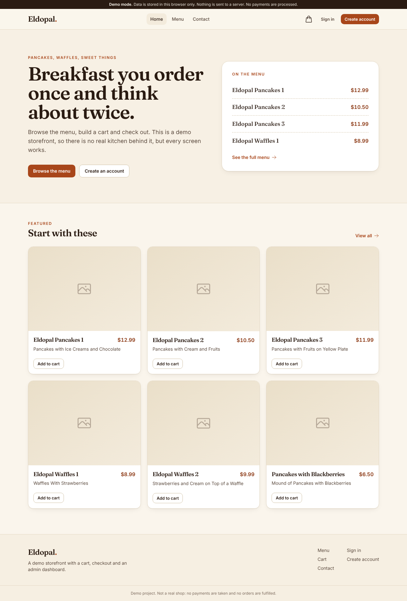
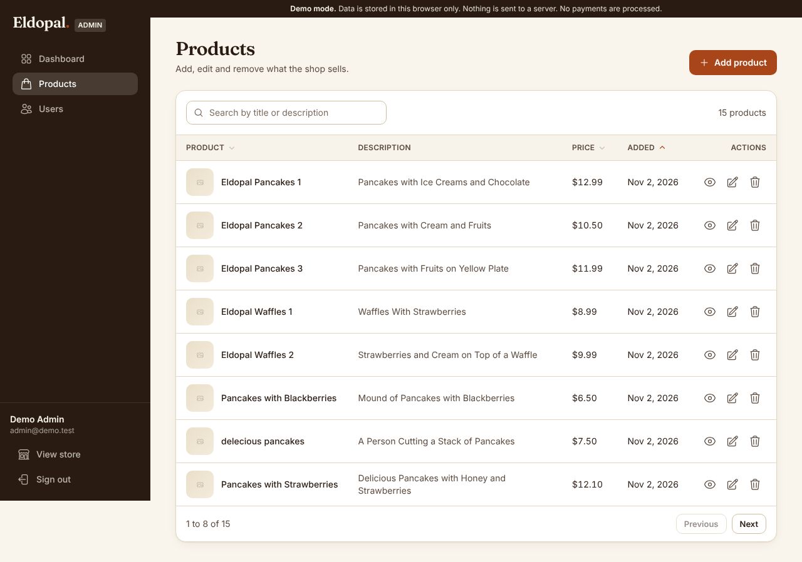

# Eldopal: storefront and admin dashboard with Strapi

A small online shop (pancakes and waffles) with a customer storefront and an admin
dashboard. The frontend is React, Vite and Tailwind CSS. The backend is Strapi 5 with
PostgreSQL. The frontend also has a **demo mode** that needs no server at all.

Live demo: https://e-commerce-with-dashboard-neon.vercel.app (this link may still serve the
earlier version of the app until it is redeployed from this branch).




Product photos come from remote URLs stored in the data. When an image cannot load, the app
shows a neutral placeholder, which is what the screenshots show because the sandbox they were
taken in had no access to those hosts.

## Repository layout

| Path | What it is |
| --- | --- |
| `frontend/` | React + Vite + Tailwind app (storefront and admin dashboard) |
| `my-strapi/` | Strapi 5 backend: `product` collection, users-permissions accounts and roles |
| `start.sh` | Deploy script: builds Strapi and the frontend, then starts Strapi |

## Features

Storefront: menu with search and sorting (kept in the URL), product detail pages, cart saved
in the browser, shipping and tax totals, checkout form with validation and an order
confirmation (a simulation), sign in, sign up, profile, contact form.

Admin dashboard (admins only, `/admin`): dashboard cards and price chart, products and users
tables with search, sortable columns and pagination, add, edit, view and delete products,
change user roles, delete users (never yourself).

Every data view has loading, empty and error states with a retry button. Keyboard accessible,
visible focus rings, skip link, `prefers-reduced-motion` respected.

## Run it

### Demo mode, no backend

```bash
cd frontend
npm install
npm run dev       # http://localhost:5173
```

With no environment variables the frontend uses demo mode: products and accounts live in
`localStorage`, passwords are salted and hashed with PBKDF2 (WebCrypto) and never stored in
plain text. The sign in page lists two fake demo accounts (an admin and a shopper).

### With Strapi

1. Set up and start the backend, following [`my-strapi/README.md`](my-strapi/README.md)
   (database, secrets, and the roles and permissions to create in the Strapi admin panel).
2. In `frontend/`, copy `.env.example` to `.env`. The only variable is
   `VITE_STRAPI_API_END_POINT` (the Strapi URL, with or without `/api`). Optionally
   `VITE_BACKEND=demo` forces demo mode.
3. `npm run dev`. If Strapi cannot be reached, the menu shows an error with a button to
   continue with demo data.

## Demo data

- The fake demo accounts in `frontend/src/services/demoSeed.js` (`admin@demo.test`,
  `shopper@demo.test`) are for demo mode only.
- `my-strapi/data/users.example.json` holds fake local seed accounts. Copy it to
  `data/users.json` (git-ignored) to seed them.
- `frontend/db.json` is the original json-server style seed. Only its `products` are used.
  Its `users` records are legacy data from the earlier version, are not loaded or shipped
  in the bundle, and should not be treated as real credentials.
- Shipping ($5, free over $50) and tax (5%) are demo values in `frontend/src/lib/config.js`.

## Tests and CI

`npm test` (in `frontend/`) runs Vitest unit tests for cart totals, table search, sorting and
pagination, product validation and the demo backend. GitHub Actions
(`.github/workflows/ci.yml`) runs lint, tests and a production build for the frontend.

## How this was verified

- Frontend: `npm run lint`, `npm test` and `npm run build` pass. Demo mode was driven in
  headless Chromium at 1280x800 and 390x844 (browsing, cart, checkout, admin guard, tables,
  error state and its demo fallback) with no console errors.
- Strapi integration: I ran `my-strapi` locally on SQLite (not PostgreSQL) with test roles
  and permissions, and ran the frontend's Strapi client against it: list, create, update and
  delete products, register, sign in and out, session restore, listing users, changing a role,
  deleting a user, and permission errors for anonymous and non-admin callers all behaved as
  expected. The UI was also loaded against that instance.
- Not verified: PostgreSQL, Railway deployment via `start.sh`, and the Vercel deployment.

## Changes found while reviewing the backend

- `my-strapi/scripts/seed-products.js` had a typo (`if (FileSystemWritableFileStream)`) that
  threw on every start and stopped both seeders. It now checks the published count and
  creates published documents with the Documents API.
- `my-strapi/scripts/seed-users.js` now sets `provider: "local"` so seeded users can sign in.
- `start.sh` copied the build to `public/dist`. It now copies the files into `public/`.
- The frontend read and wrote users in a Firebase Realtime Database with plain-text passwords.
  It now uses Strapi's users-permissions accounts, which hash passwords on the server.

## Known limitations

- Checkout is a simulation: no payment, no stored orders, no emails. The contact form does
  not send messages.
- Strapi usernames are unique and the frontend uses the full name as the username, so two
  people with the same full name cannot both register. Registration only accepts username,
  email and password, so the phone number is saved in a second request.
- Admin rights come from the Strapi role named `admin` and are enforced by the role's
  permissions on the server. The frontend checks are only a convenience.
- The JWT is kept in `localStorage` (or `sessionStorage` without "keep me signed in").
- CORS is the Strapi default (all origins). Restrict it before any real use.
- `vercel.json` rewrites all paths to `index.html` so deep links work on Vercel. Strapi
  serving the frontend from `public/` has no such fallback.

Notes: UI and code quality improvements were made with AI assistance (Claude, Anthropic), reviewed and verified by building and running the app.
